# Glosario visual de Valtrigo

Cada gráfico del juego, tal y como debe verse, con su nombre debajo. Sirve de referencia para detectar fallos visuales: si algo se ve distinto en el juego (otro color, otro personaje, otra forma), es un fallo que hay que reportar.

Las imágenes están ampliadas para que se vean bien; en el juego miden 16×16 píxeles por casilla.

Archivo generado con `python3 tools/generar-glosario.py`. No lo edites a mano.

## Índice

- [Personajes](#personajes)
- [Retratos](#retratos)
- [Objetos](#objetos)
- [Platos](#platos)
- [Mejoras](#mejoras)
- [Naturaleza](#naturaleza)
- [Edificios y pueblo](#edificios-y-pueblo)
- [Interiores](#interiores)
- [Huerto](#huerto)
- [Feria (día 7)](#feria-día-7)
- [Puzles y misterio](#puzles-y-misterio)
- [Interfaz](#interfaz)

## Personajes

Cada personaje mirando hacia abajo, arriba, izquierda y derecha (Bigotes solo tiene dos dibujos). El jugador y la jugadora cambian de piel y de pelo según el aspecto elegido al empezar (HU-68); aquí aparecen con el aspecto inicial y la hoja base.

<table>
<tr>
<td align="center">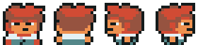 Jugador (aspecto inicial)</td>
<td align="center">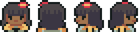 Jugadora (hoja base)</td>
<td align="center">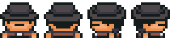 Alcalde</td>
<td align="center">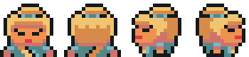 Vendedora</td>
</tr>
<tr>
<td align="center">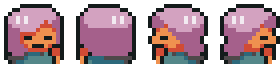 Relojera</td>
<td align="center">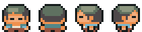 Granjero</td>
<td align="center">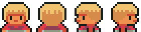 Rosa</td>
<td align="center">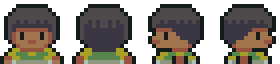 Lucía</td>
</tr>
<tr>
<td align="center">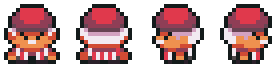 Tomás</td>
<td align="center">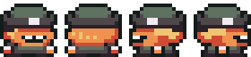 Pablo</td>
<td align="center">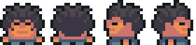 Fran</td>
<td align="center">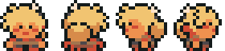 Elena</td>
</tr>
<tr>
<td align="center">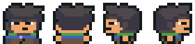 Pedro</td>
<td align="center">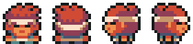 Bruno</td>
<td align="center">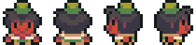 Marta</td>
<td align="center">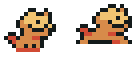 Bigotes</td>
</tr>
</table>

## Retratos

El retrato que aparece en el cuadro de diálogo de cada NPC.

<table>
<tr>
<td align="center">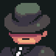 Alcalde</td>
<td align="center">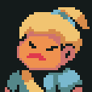 Vendedora</td>
<td align="center">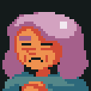 Relojera</td>
<td align="center">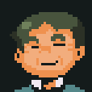 Granjero</td>
</tr>
<tr>
<td align="center">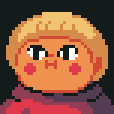 Rosa</td>
<td align="center">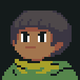 Lucía</td>
<td align="center">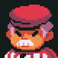 Tomás</td>
<td align="center">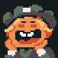 Pablo</td>
</tr>
<tr>
<td align="center">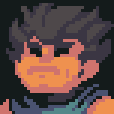 Fran</td>
<td align="center">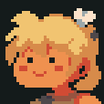 Elena</td>
<td align="center">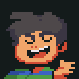 Pedro</td>
<td align="center">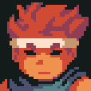 Bruno</td>
</tr>
<tr>
<td align="center">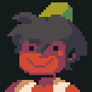 Marta</td>
<td align="center">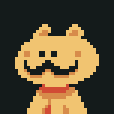 Bigotes</td>
</tr>
</table>

## Objetos

El icono de cada objeto en el inventario y en la tienda.

<table>
<tr>
<td align="center">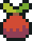 Manzana</td>
<td align="center"> Semilla</td>
<td align="center"> Semilla de zanahoria</td>
<td align="center">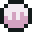 Semilla de calabaza</td>
</tr>
<tr>
<td align="center">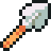 Pala</td>
<td align="center">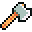 Hacha</td>
<td align="center"> Regadera</td>
<td align="center"> Caña de pescar</td>
</tr>
<tr>
<td align="center">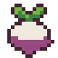 Nabo</td>
<td align="center">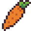 Zanahoria</td>
<td align="center">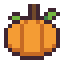 Calabaza</td>
<td align="center">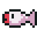 Trucha</td>
</tr>
<tr>
<td align="center">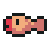 Carpa</td>
<td align="center">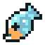 Siluro</td>
<td align="center"> Seta</td>
<td align="center">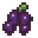 Mora</td>
</tr>
<tr>
<td align="center">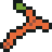 Leña</td>
<td align="center">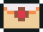 Carta del alcalde</td>
<td align="center">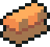 Engranaje de cobre</td>
<td align="center">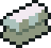 Muelle de plata</td>
</tr>
<tr>
<td align="center">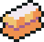 Péndulo de oro</td>
<td align="center">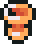 Copa de Valtrigo</td>
<td align="center">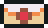 Carta para Tomás</td>
<td align="center">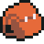 Paquete</td>
</tr>
</table>

## Platos

Los platos que se cocinan en el fogón (HU-84).

<table>
<tr>
<td align="center">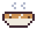 Sopa de setas</td>
<td align="center"> Tarta de moras</td>
<td align="center"> Carpa asada</td>
<td align="center"> Guiso de calabaza</td>
</tr>
</table>

## Mejoras

El icono de cada mejora en la pestaña "Mejoras" de la tienda (HU-85). Reutilizan iconos de objetos.

<table>
<tr>
<td align="center"> Mochila grande</td>
<td align="center"> Regadera grande</td>
<td align="center"> Caña buena</td>
</tr>
</table>

## Naturaleza

Árboles, plantas y agua de las zonas exteriores. Los árboles altos ocupan dos casillas.

<table>
<tr>
<td align="center"> Árbol alto verde</td>
<td align="center"> Árbol alto otoñal</td>
<td align="center"> Árbol pequeño verde</td>
<td align="center"> Árbol pequeño otoñal</td>
</tr>
<tr>
<td align="center"> Arbusto</td>
<td align="center"> Manzano (granja)</td>
<td align="center"> Setas (bosque)</td>
<td align="center"> Arbusto de moras (bosque)</td>
</tr>
<tr>
<td align="center"> Tronco para talar (bosque)</td>
<td align="center"> Césped</td>
<td align="center"> Camino de tierra</td>
<td align="center"> Agua del lago (centro, brillo y orilla)</td>
</tr>
</table>

## Edificios y pueblo

Edificios de la plaza, la granja y el barrio, y lo que hay por las calles.

<table>
<tr>
<td align="center"> Casa (del jugador y del barrio)</td>
<td align="center"> Tienda</td>
<td align="center"> Torre del reloj</td>
<td align="center"> Granero</td>
</tr>
<tr>
<td align="center"> Cercado del granero</td>
<td align="center"> Fuente de la plaza</td>
<td align="center"> Cartel</td>
<td align="center"> Tablón de anuncios</td>
</tr>
</table>

## Interiores

Suelos, paredes y muebles de la casa del jugador, la tienda, la torre y las casas del barrio.

<table>
<tr>
<td align="center"> Suelo de casa</td>
<td align="center"> Suelo de la tienda</td>
<td align="center"> Suelo de la torre</td>
<td align="center"> Pared</td>
</tr>
<tr>
<td align="center"> Puerta</td>
<td align="center"> Estantería</td>
<td align="center"> Estantería ancha</td>
<td align="center"> Mesa</td>
</tr>
<tr>
<td align="center"> Silla</td>
<td align="center"> Barril</td>
<td align="center"> Banco de trabajo (torre)</td>
<td align="center"> Cama</td>
</tr>
<tr>
<td align="center"> Fogón</td>
<td align="center"> Cofre (cerrado y abierto)</td>
<td align="center"> Mecanismo del reloj (torre)</td>
<td align="center"> Campanas (grande, mediana y pequeña)</td>
</tr>
</table>

## Huerto

Las fases de una parcela del huerto. Una parcela regada se ve más oscura.

<table>
<tr>
<td align="center"> Tierra cavada</td>
<td align="center"> Recién sembrado</td>
<td align="center"> Brote</td>
<td align="center"> Creciendo</td>
</tr>
<tr>
<td align="center"> Nabo listo</td>
<td align="center"> Zanahoria lista</td>
<td align="center"> Calabaza lista</td>
</tr>
</table>

## Feria (día 7)

La decoración de la plaza el día de la feria.

<table>
<tr>
<td align="center"> Guirnalda</td>
<td align="center"> Poste de la guirnalda</td>
<td align="center"> Puesto de la cosecha</td>
<td align="center"> Puesto de pesca</td>
</tr>
<tr>
<td align="center"> Escenario</td>
<td align="center"> Podio</td>
</tr>
</table>

## Puzles y misterio

Los puzles del bosque y de la granja y las páginas del diario.

<table>
<tr>
<td align="center"> Losa (apagada y encendida)</td>
<td align="center"> Caja</td>
<td align="center"> Marca del suelo</td>
<td align="center"> Página del diario</td>
</tr>
</table>

## Interfaz

Los iconos de los recuadros de arriba durante la partida.

<table>
<tr>
<td align="center"> Sol (de día)</td>
<td align="center"> Luna (de noche)</td>
<td align="center"> Moneda (dinero)</td>
<td align="center"> Rayo (energía)</td>
</tr>
</table>
